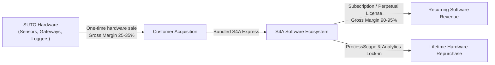
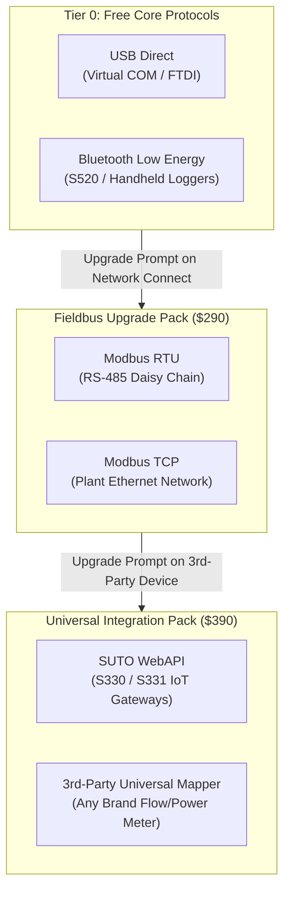
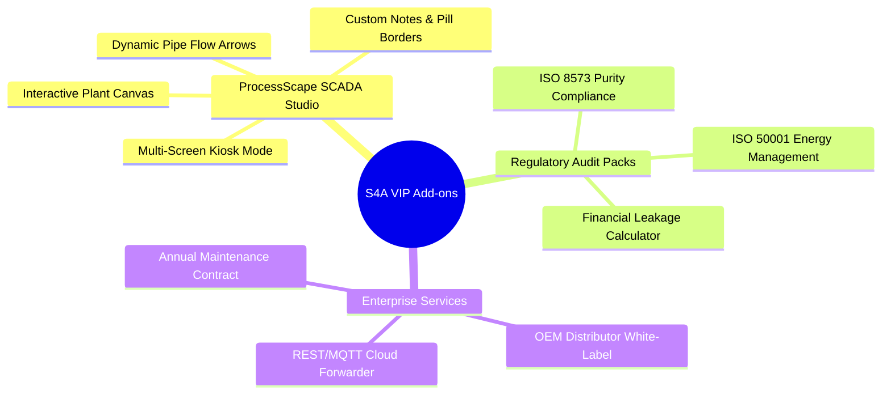
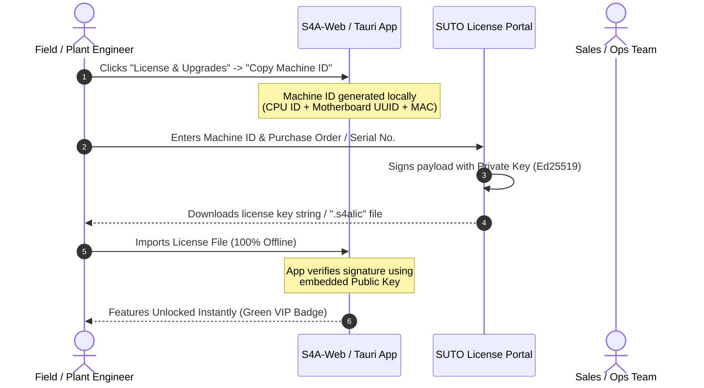
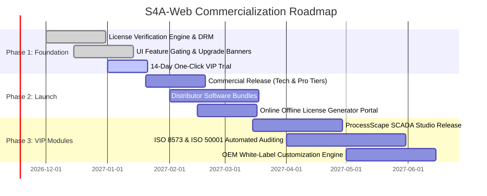

# S4A-Web: Commercial Monetization, Licensing & Go-to-Market Strategy Report

**Document Title:** Commercial Monetization, Licensing & Go-to-Market Strategy Report  
**Target Product:** `s4a-web` (Cross-Platform Compressed Air & Industrial Gas Monitoring Suite)  
**Target Audience:** Product Managers (PM), Marketing Directors, Business Development & Sales Leadership  
**Document Version:** 2.0 (Executive & Commercial Edition)  
**Classification:** Strategic Product Roadmap & Commercial Packaging  

---

## 1. Executive Summary & Market Opportunity

Compressed air is universally regarded as the **"Fourth Utility"** in manufacturing (alongside electricity, water, and natural gas). It is also the most inefficient: up to **30% of an industrial plant's electricity bill** is consumed by air compressors, with **20% to 40% of generated air lost to leaks and poor pressure regulation**.

While hardware sensors (flow meters, dew point sensors, power meters, particle counters) are mature commodities, **software is where sustainable, high-margin revenue and customer lock-in are won.**

### Key Business Metrics
* **Total Addressable Market (TAM):** $4.2B Global Compressed Air Quality & Energy Management.
* **Serviceable Obtainable Market (SOM):** $280M Industrial IoT & Compressed Air Monitoring Software.
* **Target Software Gross Margin:** **92% – 95%** (vs. 28% – 38% for sensor hardware).
* **Core Value Proposition:** Zero-install web & native offline desktop app with sub-second parsing of multi-gigabyte logs, direct hardware interconnects, and plant-level digital twin visualization (`ProcessScape`).

---

## 2. Customer Personas & Pain Points

Understanding the core buyers enables tailored packaging, pricing, and sales messaging.

| Buyer Persona | Role & Industry | Primary Pain Points | Willingness to Pay | Buying Decision Driver |
| :--- | :--- | :--- | :--- | :--- |
| **Persona A: Field Service Technician** | Independent contractor, HVAC/Pneumatics auditor | Carrying heavy laptops, slow file exports on customer sites, software crashes on large logs | **Medium** ($300 – $600 one-off) | Speed on site, portable tablet/laptop support, instant CSV/CSD exports |
| **Persona B: Plant Maintenance Manager** | Factory utility manager (Automotive, F&B, Pharma) | Scattered data, no live visibility into compressor room, undetected leaks causing high energy bills | **High** ($1,500 – $4,000 per plant) | Real-time monitoring, pipe layout visualization, automated leak alarms |
| **Persona C: Quality & ESG Director** | Compliance manager, Sustainability lead | Strict ISO 8573 (air purity) & ISO 50001 (energy) audits, preparing compliance reports manually | **Very High** ($3,000 – $8,000 corporate) | Standardized audit certificates, automated monthly energy savings reports |
| **Persona D: SUTO Distributor / OEM** | Compressed air equipment dealer & packager | Low hardware margins, commoditized sensor bidding, lack of differentiated software | **Partner Volume** (30-40% wholesale margin) | Ability to white-label, bundle with compressor packages, recurring service revenue |

---

## 3. Product Packaging & Tiering Matrix

We propose a **4-tier product packaging structure** designed to maximize initial adoption while creating natural commercial upgrade triggers as customer installations grow.

| Feature / Module | Tier 0: Starter / Express | Tier 1: Field Technician | Tier 2: Plant Professional | Tier 3: Enterprise VIP Suite |
| :--- | :---: | :---: | :---: | :---: |
| **Commercial Model** | **Free (Bundled with Sensor)** | **$490 Perpetual** / $180/yr | **$1,490 Perpetual** / $450/yr | **$3,800 Site License** / $950/yr |
| **Target User** | Single sensor buyer | Independent auditor | Factory maintenance team | Multi-building industrial plant |
| **Max Concurrent Devices** | **1 Device** | **2 Devices** | **16 Devices** | **Unlimited** |
| **Allowed Locations / Scapes** | 1 Location (Default View) | 3 Locations | 10 Locations | Unlimited Locations & Scapes |
| **Communication Protocols** | | | | |
| • USB Direct (Virtual COM) | Full | Full | Full | Full |
| • Bluetooth Low Energy (BLE) | Full | Full | Full | Full |
| • Modbus RTU (RS-485 Serial) | Read-only check | Full Logging & Control | Full Logging & Control | Full Logging & Control |
| • Modbus TCP (Industrial Ethernet) | Locked | Full (1 Subnet) | Full Multi-Subnet | Full Enterprise Grid |
| • SUTO Gateway WebAPI (S330/S331) | Locked | 1 Gateway | Up to 4 Gateways | Unlimited Gateways |
| • 3rd-Party Generic Modbus Mapper | Locked | Locked | Standard Presets | **Full Custom Register & Resolution** |
| **Data Logging & Analysis** | | | | |
| • Binary CSD Streaming Engine | Standard Speed | High-Speed Stream | High-Speed Stream | Batch Ultra Engine |
| • CSV File Analysis & Gap Detection | Max 50 MB | Unlimited File Size | Unlimited File Size | Unlimited File Size |
| • Live Multi-Channel Recording | Locked (View only) | Yes (to CSV/CSD) | Yes (Synchronous multi-sensor) | Yes (24/7 Background Service) |
| • Data Modifier (Math Channels) | Locked | Basic Formulas (+, -, *, /) | Full Math & Calibration Curves | Virtual Sensors & Cost Formulae |
| **ProcessScape (SCADA Engine)** | | | | |
| • ProcessScape Runtime Viewer | Read-only Default | Yes | Yes | Yes |
| • ProcessScape Studio / Designer | Locked | Locked | Standard Layout Editor | **VIP Studio (Pipes, Anchors, Custom Notes)** |
| • Custom Note Borders & Typography | Locked | Locked | Basic Labels | **Full (Pill, Double, Dotted, Custom Sizing)** |
| • High-Res Diagram Export | Watermarked (72 DPI) | Standard HD (1080p) | 4K Vector SVG/PNG | Print-Ready CAD & Vector Export |
| • Multi-Screen Kiosk Mode | Locked | Locked | Single Screen | Multi-Monitor Wallboard Mode |
| **Compliance & Reporting** | | | | |
| • Basic PDF Chart Export | Standard | Standard | Branded | White-Label Custom Header |
| • ISO 8573 Air Quality Audit | Locked | Preview Only | Full Generator | One-Click Certified Audit Report |
| • ISO 50001 Energy & Leakage Cost | Locked | Locked | Included | Automated Monthly ESG Delivery |

---

## 4. Hardware Communication & Protocol Monetization Strategy

In industrial automation, **protocol gating** is an established industry standard (used by Siemens, Rockwell, Schneider, and Kepware). It allows selling entry-level products cheaply while capturing high willingness-to-pay from enterprise integrations.

### Detailed Protocol Value & Monetization Breakdown

| Protocol Name | Transport Layer | Market Target | In-App Upsell Trigger / Hook | Add-on Price (A La Carte) |
| :--- | :--- | :--- | :--- | :--- |
| **USB Direct** | Virtual COM / FTDI cable | Bench calibration, single sensor audit | Included free with hardware | **Free** |
| **Bluetooth Low Energy** | Native Web Bluetooth / BLE | Handheld field checks without opening panels | Included free with hardware | **Free** |
| **Modbus RTU** | RS-485 2-wire serial | Multi-sensor fieldbus in compressor room | Triggered when user attempts to add a 2nd slave ID on serial bus | **$190** (or bundled in Pro) |
| **Modbus TCP** | RJ45 Ethernet / Industrial LAN | Plant-wide network integration into IT/OT network | Triggered when user enters an IP address and clicks "Connect" | **$290** (or bundled in Pro) |
| **SUTO WebAPI** | HTTP REST / IoT Gateway | Centralized data loggers (S330 / S331 / S332) | Triggered when connecting to SUTO gateway IP | **$250** (or bundled in Pro) |
| **3rd-Party Universal Mapper** | Modbus TCP / RTU (FC03/04) | Connecting competitor sensors (Endress+Hauser, Festo, IFM) | Triggered when selecting custom resolution (`0.001`) or non-SUTO registers | **$390** (or bundled in Enterprise) |

---

## 5. VIP Feature Catalog & High-Margin Add-on Modules

Beyond base software tiers, these modular add-ons address specific high-value customer needs.

### VIP Add-on Module Specifications

| Module Code | Module Name | Customer Problem Solved | Target Audience | Standalone Price | Bundle Inclusion |
| :--- | :--- | :--- | :--- | :---: | :---: |
| **VIP-SCADA** | **ProcessScape™ Dynamic SCADA Studio** | Building a 2D SCADA plant screen in traditional systems costs $5,000+. ProcessScape lets users build a full compressor room twin with dynamic pipes, anchors, and styled text notes in 30 minutes. | Plant Managers, System Integrators | **$650** | Enterprise VIP |
| **VIP-8573** | **ISO 8573 Air Purity Compliance Pack** | Pharma and food plants must produce audited air purity proof. This module automatically grades particle, humidity, and oil channels into ISO classes and creates an audit certificate. | Quality Assurance, Regulated Plants | **$850** | Enterprise VIP |
| **VIP-50001** | **Energy & Leakage Cost Calculator** | Converts physical CFM and kW telemetry directly into localized dollars/euros lost to leaks, and benchmarks compressor specific power ($kW / m^3/min$). | Energy Auditors, Sustainability Leads | **$590** | Pro & Enterprise |
| **VIP-OEM** | **Distributor White-Label Branding** | Distributors want to protect their customer relationships by displaying their own logo, company colors, and contact info in the app and on reports. | SUTO Distributors, Compressor Dealers | **$2,500** setup + $1,000/yr | Enterprise Custom |
| **VIP-BRIDGE** | **Enterprise MQTT / REST Cloud Bridge** | Plants want to stream telemetry from local S4A into central cloud platforms (AWS IoT, Azure, or factory ERP/MES). | Corporate IT/OT Engineers | **$750** | Enterprise VIP |

---

## 6. Frictionless License DRM for Air-Gapped Industrial Plants

**The Golden Rule of Industrial Software:** Never lock an engineer out of their data while they are standing on a factory floor without an internet connection.

### License Types Comparison

| License Type | Deployment Form | Best Suited For | Internet Needed? | Portability |
| :--- | :--- | :--- | :---: | :--- |
| **Machine-Locked File (`.s4alic`)** | Cryptographic token locked to PC hardware ID | Fixed plant control workstations, field laptops | **Zero (100% Offline)** | Single assigned PC |
| **Technician USB Dongle** | Hardware USB key with embedded crypto chip | Field service technicians who work on 10+ different customer PCs | **Zero (100% Offline)** | Fully portable with USB |
| **Cloud Subscription Key** | 16-character alphanumeric key | Modern connected plants, corporate headquarters | Every 30 days (Grace Period) | Transferable between seats |

---

## 7. Sales Channel Strategy & Distributor Enablement

### Commercial Turnkey Hardware + Software Bundles

| Bundle Name | Hardware Included | Software Tier Included | Package List Price | Customer Savings | Target Buyer |
| :--- | :--- | :--- | :---: | :---: | :--- |
| **Field Auditor Kit** | S520 Handheld Flow/Dewpoint Meter + Bluetooth Dongle | **Tier 1: Field Technician** | **$4,950** | Save $250 vs separate | Energy consulting firms |
| **Compressor Room Master Kit** | 1x S401 Flowmeter + 1x S220 Dewpoint + 1x Power Meter | **Tier 2: Plant Professional** | **$7,800** | Save $600 vs separate | Factory maintenance managers |
| **Plant-Wide SCADA Turnkey** | 1x S331 Gateway + 8x Flow/Dewpoint Sensors | **Tier 3: Enterprise VIP Suite** | **$18,500** | Save $1,800 vs separate | Major manufacturing facilities |

---

## 8. Sales Objection Handling Battlecard

Equipping sales reps and distributors with quick responses to common customer objections:

| Customer Objection | Root Cause / Concern | Winning Sales Response |
| :--- | :--- | :--- |
| *"Why should I pay for S4A when other sensor brands give software away for free?"* | Used to low-quality, buggy free utility tools | *"Free vendor software only opens small files, crashes on large datasets, and only works with one sensor over USB. S4A is an industrial SCADA platform that maps your entire piping layout, parses multi-gigabyte logs instantly, and monitors your whole plant concurrently."* |
| *"Our factory network is strictly air-gapped. We cannot use cloud-licensed software."* | Fear of cybersecurity risk and IT compliance rejection | *"S4A was specifically built for industrial air-gapped security. It runs 100% offline on local machines, requires zero internet access, stores all data locally, and activates via offline cryptographic license files."* |
| *"We already have existing flowmeters from Endress+Hauser and IFM. Why switch?"* | Reluctance to discard existing capital hardware | *"You don't need to switch! With S4A’s Universal 3rd-Party Modbus Mapper, you can integrate your existing Endress+Hauser, Festo, and IFM meters alongside your SUTO sensors into one unified ProcessScape dashboard."* |
| *"What happens if our subscription expires during a critical audit?"* | Fear of sudden operational blackout | *"Our commercial licenses are perpetual with optional maintenance. Once purchased, your core monitoring never expires. You retain perpetual ownership of your software and plant scapes."* |

---

## 9. 3-Year Financial Forecast & Revenue Model

Based on an estimated annual baseline of 4,000 SUTO hardware sensor units sold globally and conservative software attach rates:

| Financial Metric | Year 1 (Launch) | Year 2 (Expansion) | Year 3 (Maturity) |
| :--- | :---: | :---: | :---: |
| Active Free / Starter Users | 3,500 | 7,800 | 14,000 |
| **Tier 1: Field Tech Licenses Sold ($490)** | 280 units ($137,200) | 550 units ($269,500) | 900 units ($441,000) |
| **Tier 2: Plant Pro Licenses Sold ($1,490)** | 140 units ($208,600) | 320 units ($476,800) | 550 units ($819,500) |
| **Tier 3: Enterprise VIP Sold ($3,800)** | 35 units ($133,000) | 80 units ($304,000) | 160 units ($608,000) |
| **VIP Add-on Modules Sold (Avg $650)** | 120 units ($78,000) | 290 units ($188,500) | 520 units ($338,000) |
| **Annual Software Maintenance Renewals (20%)** | $0 | $95,760 | $238,960 |
| **Total Annual Software Revenue** | **$556,800** | **$1,334,560** | **$2,445,460** |
| Software Gross Margin | **92.5%** | **94.0%** | **95.2%** |
| **Net Software Gross Profit Contribution** | **$514,940** | **$1,254,486** | **$2,328,078** |

---

## 10. Product Roadmap & Phased Commercial Rollout

### Strategic Recommendations for the PM & Marketing Team

1. **Implement the In-App 14-Day Free VIP Trial First:**
   Let users experience ProcessScape pipe drawing and multi-device recording immediately. Experience drives conversion much faster than static marketing brochures.
2. **Train Distributors on the High-Margin Software Upsell:**
   Provide SUTO regional sales reps and distributors with turn-key presentation slides showing how adding $1,490 of software turns a $3,000 hardware quote into a $4,500 high-margin solution.
3. **Keep Starter Free for SUTO Hardware:**
   Never charge for single-device USB/BLE access. Free basic utility ensures high market share and keeps competitors from wedging into accounts.
4. **Position ProcessScape as the Crown Jewel:**
   Make ProcessScape visuals the centerpiece of all marketing videos, exhibition booths, and catalog covers. Visual digital twins capture customer interest immediately.

