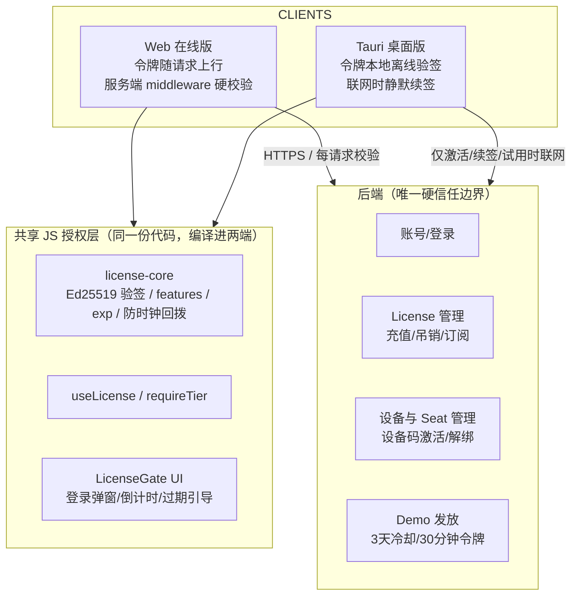
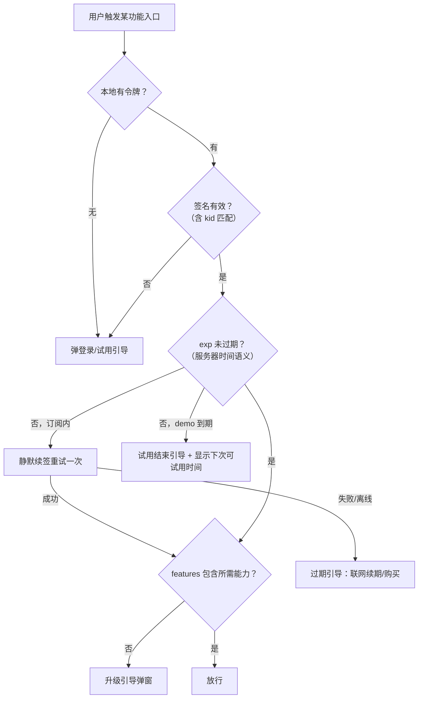
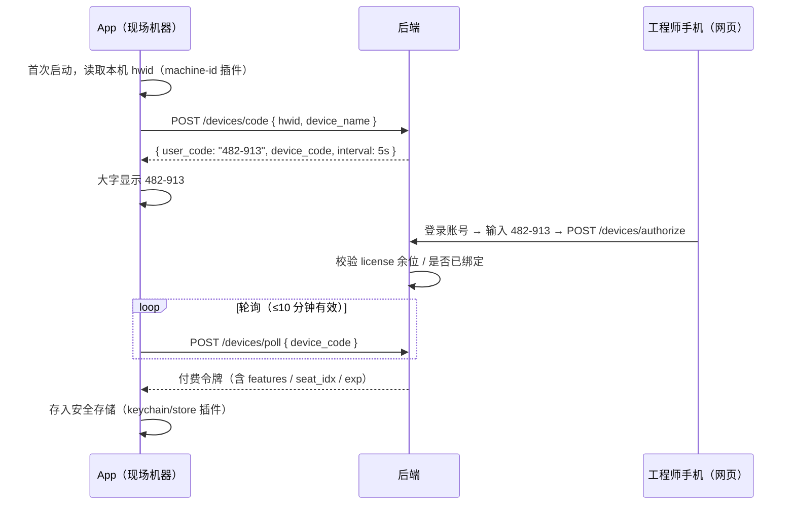
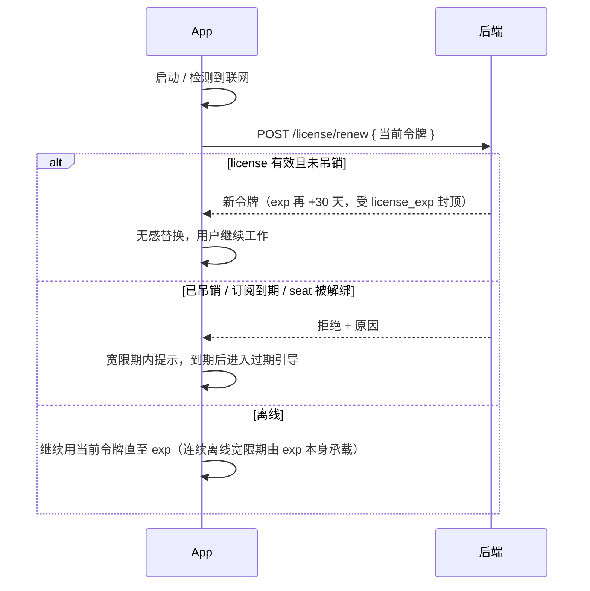
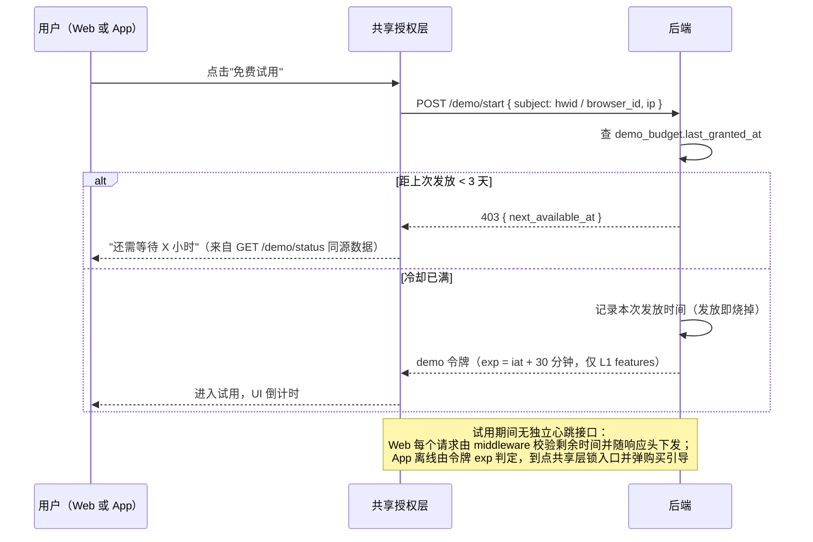

# S4A 授权/限制体系 —— 设计全量总结（v2）

> 更新时间：2026-10-24
> 适用对象：s4a-web（Web 在线版）+ s4a-web Tauri 桌面版
> 目标：网站（在线模式）+ Tauri App（离线模式）统一使用同一套 license；离线可验签；demo（免费试用）规则为**每 3 天可用 30 分钟**。

**v2 相对初版的关键修订**（讨论结论，正文均已并入）：

1. **v1 不写任何 Rust 业务代码**。Tauri 的 Rust 层（`src-tauri/src/suto/`，USB/TCP/BLE 通信引擎）当作黑盒，授权逻辑全部放在两端共享的 JS 层 → 两端行为一致由"跑同一份代码"保证，而不是两端分别实现。
2. **验签统一用 `@noble/ed25519`**（纯 JS），浏览器与 Tauri webview 行为完全一致，无 WebCrypto 兼容性问题。
3. **App 激活改用设备码（Device Code）流程**：不在现场工控机上输账号密码，用手机完成授权。
4. **付费令牌改"短有效期 + 联网静默续签"**，替代"年度硬到期"；订阅到期日与令牌有效期分离。
5. **砍掉 `/demo/heartbeat`**：Web 端所有敏感请求本来就要过服务端 middleware，剩余时间随响应下发即可。
6. **诚实边界写进设计**：两端 JS 层 gating 均为软限制；服务端是唯一硬卡点；Rust 收口列为 v2 可选加固。

---

## 0. 设计目标与约束

| 约束 | 含义 |
|---|---|
| **两端行为一致** | 登录弹窗、过期提示、demo 倒计时、功能入口拦截等所有授权相关 UI/逻辑，Web 与 App 逐字节相同（同一份模块编译进两端） |
| **现场弱网友好** | 激活、续签、demo 发放都需要联网，但每次只需几十秒；正常使用阶段 App 完全离线 |
| **v1 零 Rust 业务代码** | 不修改 `suto` 引擎；仅允许"加插件"级别的配置改动（见 §10） |
| **防作弊定位** | 目标是"诚实用户 + 提高破解门槛"，不是 DRM 级防护；B2B 工具强度够用 |

---

## 1. 总体架构



### 信任边界一览（哪层是"硬"的）

| 层 | 位置 | 强度 | 说明 |
|---|---|---|---|
| 服务端 middleware | 后端 | **硬** | license 管理、demo 发放、续签及未来一切云端功能，真正防住 |
| 共享 JS 授权层 | 前端 | 软 | 拦 UI 入口、驱动流程；懂技术者可绕过 |
| Rust 引擎收口 | `suto_connect_*` | 硬（**v2 可选**） | v1 不做；见 §10 |

> 注意不对称性：**Web 端的 L1 能力（Web Bluetooth 连表）发生在浏览器里，服务端没有接口可卡**——Web 端设备连接类限制只能是软限制。App 端的 JS 打包在二进制内、发布版默认关 devtools，篡改难度高一截，但 v1 同样属于软限制。

---

## 2. 功能分层（登录限制的基准）

| 层级 | 说明 | 权限要求 | Web 执行强度 | App 执行强度 |
|---|---|---|---|---|
| **L0 开放** | 不碰受保护资源（CSV 导入、图表查看、历史文件管理） | 无需登录（两端一致） | — | — |
| **L1 高级** | 设备连接（USB/TCP/BLE）、读表、在线监控 | 登录（正式账号或 demo） | 软（无服务端卡点） | 软（v1）/ 硬（v2 Rust 收口后） |
| **L2 商业** | 导出、批量修改、报告生成等 | 有效 license 的对应 features | 硬（凡走服务端的部分）/ 软（纯客户端部分） | 同 Web |

**核心原则**：限制的关键不是"是否登录"，而是"卡在哪个卡点上"。走服务器的都是硬的；纯客户端的靠共享 gating 层拦诚实用户。

> 具体功能 → L0/L1/L2 的映射是产品决策，维护在共享 feature 枚举中（§11 第 0 步），避免三端字符串漂移。

---

## 3. 前端共享授权层

目录结构（新增，均为纯 JS）：

```
src/license/
  license-core.js        # 纯函数：验签、claims 解析、features 检查、exp 判断、max_seen_time
  useLicense.js          # React Hook：requireTier(feature)，未授权→弹窗，过期→续期引导
  LicenseGate.jsx        # 统一 UI：登录弹窗 / demo 倒计时条 / 过期与购买引导
  adapters/
    web.js               # localStorage 存令牌 / navigator.onLine / 无 hwid（浏览器匿名 ID）
    tauri.js             # 安全存储插件 / 联网检测 / machine-id（hwid）
```

**设计规则**：

- 平台差异**只允许出现在 adapters**，其余代码两端逐字节相同 → 行为一致由构造保证。
- 所有权益判断只依据**令牌 claims**（服务器时间）；本地时钟只用于回拨检测，不参与权益判断 → 避免两端时钟差异导致行为不一致。
- 令牌验签：`@noble/ed25519`（纯 JS，两端一致；公钥内置多把，按 `kid` 选择，见 §4）。

### requireTier 判定流程



---

## 4. 令牌设计

格式：**Ed25519 签名 JWT**。私钥仅在 license 服务端（建议 KMS/HSM 或独立离线发码机）；公钥组内置在前端（Web 与 App 共用同一份公钥组）。

### 4.1 付费令牌（长期订阅 + 短期令牌滚动续签）

```json
{
  "iss": "s4a-license",
  "sub": "123",                       // user id
  "iat": 1761135600,
  "exp": 1763727600,                  // 令牌有效期：签发+30天（绝对 epoch 秒）
  "jti": "b3f1c2e8-…",
  "kid": "k2026a",                    // 签名密钥编号（轮换用）
  "tier": "paid",
  "hwid": "a1b2c3…",                  // 绑定设备哈希
  "features": ["basic", "connect", "readout", "online", "export"],
  "seat_idx": 1,                      // 结构化字段，不放假文案
  "seat_total": 3,
  "license_exp": 1829011200           // 订阅到期日（年度），与令牌 exp 分离
}
```

**两类到期分离**（关键修订）：

| 字段 | 含义 | 到期后果 |
|---|---|---|
| `exp` | 令牌有效期（30 天滚动） | 联网时静默续签，用户无感；连续离线可用至 `exp`（+宽限策略） |
| `license_exp` | 订阅到期（年度） | 续签被服务端拒绝 → 强制重新购买/登录，防盗版码永久可用 |

好处：吊销时效从"最长 1 年"缩短到"最长 1 个令牌周期"；正常联网用户完全无感。

### 4.2 Demo 试用令牌（短命）

```json
{
  "iss": "s4a-license",
  "sub": "demo",
  "iat": 1761135600,
  "exp": 1761137400,                  // 发放时刻 + 30 分钟（绝对 epoch 秒，非 "14:35"）
  "jti": "…",
  "kid": "k2026a",
  "tier": "demo",
  "hwid": "a1b2c3…",                  // App 端绑定；Web 端绑定浏览器匿名 ID
  "features": ["basic", "connect", "readout", "online"]   // 仅 L1，不含 L2
}
```

### 4.3 校验要点

- **验签**：`@noble/ed25519`，按 header `kid` 从内置公钥组选钥匙。
- **密钥轮换**：客户端内置"当前 + 备用"至少两把公钥；服务端轮换时先双发一段时间；`kid`→公钥映射随版本更新。单私钥泄漏 = 全部 license 可伪造，且老客户端换不掉钥匙，故必须有轮换预案。
- **时间规则**：权益判断只用 `exp`/`iat`（服务器时间语义）；本地时钟仅用于回拨检测。
- **防时钟回拨**：持久化 `max_seen_time`（App 存安全存储，Web 存 localStorage），检测到本地时间早于它且令牌因此"复活"时，以 `max_seen_time` 为准判 `exp`；留几分钟容差吸收 NTP 正常校正。
- **日志纪律**：任何日志（含 `suto_log_client_event`）不得输出令牌内容。

---

## 5. 核心流程

### 5.1 登录（Web）与令牌获取

Web 登录成功 → 服务端下发同一格式的 Ed25519 JWT → 前端共享层验签后进入正常使用；此后**每个服务端请求携带令牌，middleware 做硬校验**（features、有效期、吊销状态）。前端不另设验签信任——middleware 才是真相源，前端验签只为两端代码一致与快速失败。

### 5.2 设备码激活（App，现场友好）

App 端不输账号密码。现场工控机显示短码，工程师用手机在网页完成授权。



要点：

- **App 永不接触密码**；现场机器无键盘也能走完流程。
- 服务端校验：hwid 已激活 → 直接续发；license 无空位 → 手机端提示先解绑。
- **Seat 限制**：每 license 最多 N 台；换机/重装在网页账号中心解绑再绑，限次数（如一年 3 次）。hwid 漂移（重装系统）按"消耗一次换绑额度"处理，不自动占新坑。

### 5.3 静默续签与离线宽限（App）



策略参数（默认值，产品可调）：令牌 `exp` = 30 天；连续离线宽限即"用完当前令牌为止"；订阅 `license_exp` 年度到期强制联网一次。

### 5.4 Demo 试用（两端同一流程，令牌均由服务端签发）



---

## 6. Demo 规则 —— 每 3 天可用 30 分钟

**规则：`last_granted_at + 72h` 内拒绝再次发放；发放即获得连续 30 分钟，过期作废。**

| 项 | 规定 |
|---|---|
| 计数主体 | 按使用者而非 demo 账号：App 用 `hwid`；Web 用浏览器匿名 ID（localStorage）+ IP 辅助风控（IP 不做硬限，防 NAT 误伤） |
| 冷却锚点 | **发放时刻起算**（比"累计时长"少争议、难钻空子） |
| 时长语义 | **发放即烧掉**：30 分钟从发放时刻连续计，不暂停、不结转——产品文案必须写死，避免客诉 |
| 时间表示 | 一律绝对 epoch 秒；令牌带 `iat`/`exp` |
| 再试用 | 必须再过服务端（3 天冷却挡住反复重开） |
| 状态查询 | `GET /demo/status` 返回 `next_available_at`，两端显示倒计时，减少无效请求与客服量 |
| 令牌防搬运 | 绑 hwid（App）/浏览器 ID（Web），30 分钟自动失效 |

产品可选项（建议 A/B 后决定）：**首次试用 60 分钟、后续每次 30 分钟/3 天**。理由：BLE 现场连表、配对常吃掉十几分钟，30 分钟可能不够用户摸到价值点。

---

## 7. 数据模型

```
users            id, email, password_hash, created_at, ...
licenses         code(高熵防枚举), features(JSON), plan,
                 expire_at(订阅), seat_total, status(active/revoked),
                 seat_unbind_used(年度解绑次数已用)
devices          user_id, license_id, hwid(哈希), name,
                 activated_at, last_seen, revoked
demo_budget      subject(hwid/browser_id 唯一索引),
                 last_granted_at, next_available_at
ip_events        subject, ip, ts          -- 独立风控表，与主表分离，设保留期限
audit_log        event_type(activation/redeem/unbind/demo_grant/renew),
                 user_id, license_id, hwid, ip, ts, detail(JSON)
```

补充说明：

- `audit_log` 为排查盗码/滥用必备，激活、兑换、解绑、试用发放、续签失败均落一条。
- hwid 只存哈希；隐私政策声明采集内容；IP 设保留期限（合规）。

---

## 8. 后端接口（最小集）

```http
POST   /auth/register          注册
POST   /auth/login             登录（发 Ed25519 JWT）
GET    /me                     当前身份 + features + 各类剩余时间（含 demo）

POST   /license/redeem         输码入账（code 高熵；按账号+IP 限流）
GET    /license/my             我的 license：features、已绑/总设备数、到期日
POST   /license/renew          静默续签（校验订阅/吊销/seat → 滚动发新令牌）

POST   /devices/code           App 发起设备码激活（hwid → user_code）
POST   /devices/authorize      网页端授权该码（手机操作）
POST   /devices/poll           App 轮询换取付费令牌
GET    /devices                列出我的绑定设备
DELETE /devices/:id            解绑（限次数）

POST   /demo/start             发放 30 分钟 demo 令牌（含 3 天冷却校验）
GET    /demo/status            查询下次可试用时间
```

说明：

- 已砍掉 `/demo/heartbeat`：剩余时间随响应头（如 `X-License-Remaining`）下发，UI 掐表只管体验不做安全。
- Web 与 App 的令牌同格式、同验签，仅获取渠道不同（登录会话 vs 设备码/续签）。
- Web 部署为单文件静态站（vite-plugin-singlefile），与后端大概率跨域：**鉴权用 Bearer token**（比 cookie 省掉 SameSite/CORS 一堆坑），全部接口按 IP + 主体限流。

---

## 9. 防作弊要点与诚实边界

| 漏洞 | 防法 | 强度 |
|---|---|---|
| 30 分钟一到重开 App/换浏览器再试 | 服务端按 hwid/浏览器 ID 记 3 天冷却，重复申请直接拒绝 | **硬** |
| 清 cookie / localStorage | IP 辅助风控合并计数（不硬限，防 NAT 误伤） | 半 |
| 复制 demo/付费令牌给他人 | 令牌绑 hwid/浏览器 ID，且短 `exp` | 硬（付费）/半（Web） |
| 前端被绕过（Console / 改 JS） | Web：走服务端的能力由 middleware 硬防；纯客户端能力（Web BLE）v1 承认为软限制。App：JS 打包在二进制内、发布版关 devtools，门槛更高；v2 Rust 收口后为硬 | 软 → 硬(v2) |
| `suto_send_command`/`suto_send_raw` 透传绕过按命令 gating | v1 承认风险（引擎黑盒）；v2 在 `suto_connect_*` 收口：令牌状态绑到连接生命周期，过期主动断连，透传命令按读写白名单过滤 | v2 |
| 时钟回拨延长试用/令牌 | `max_seen_time` 持久化，判 `exp` 时取 max(本地, max_seen)；留几分钟容差 | 半 |
| 盗版 license 码永久可用 | 令牌 30 天滚动 + `license_exp` 年度封顶，续签时服务端校验吊销 | **硬** |
| 兑换接口被爆破枚举 code | code 高熵 + 账号/IP 限流 + audit_log | **硬** |
| 代理/VPN/换 IP 重试 demo | 无法 100% 防住；同 IP 频率风控即可，接受损耗 | 半 |

> 定位共识：目标是提高门槛 + 拦诚实用户转化，不是对抗专业破解者。凡是过度投入 Web 端客户端反作弊的方向，一律砍掉。

---

## 10. 分期边界：v1 / v1.5 / v2

| 阶段 | 内容 | 说明 |
|---|---|---|
| **v1** | 全 JS 共享授权层 + 后端三个起步接口（login / demo/start / demo/status） | 不碰 Rust；Web 端令牌存 localStorage，App 端令牌存 localStorage（tauri store 亦可） |
| **v1.5** | 两个 Tauri 插件：**machine-id**（取 hwid）+ **安全存储**（keychain/store） | 各为"Cargo.toml 加依赖 + lib.rs 注册 1–2 行"级别，不写 Rust 逻辑；补上后 demo 冷却防"清数据重置"、令牌防翻看 |
| **v2（可选加固）** | Rust 收口：`suto_connect_*` 入口校验令牌，令牌状态绑连接生命周期，exp 到点主动 disconnect；生产构建限制 `suto_send_raw` | 改动集中在引擎连接层一处，不影响整体设计；做不做取决于实际盗版压力 |

**买 vs 造（立项前花半天评估一次）**：账号 + license + 设备激活 + 离线验签 + 吊销 + portal，Keygen.sh / Cryptolens / LicenseSpring 均为现成服务（Keygen 原生支持 Ed25519 离线令牌与 device seats）。2–3 周内要上线 → 优先买；时间充裕、要求数据自主 → 自建。本文档按自建描述，接口语义与现成服务可一一对应。

---

## 11. 实施顺序

1. **第 0 步：feature 枚举单一定义源**（`basic`/`connect`/`readout`/`export`…），一个共享 JSON/模块，前端、（未来的）后端共用——这是所有校验的地基，防三端字符串漂移。
2. **共享授权层骨架**：`license-core` + `useLicense`/`requireTier` + `LicenseGate` + 两个 adapter，对着 mock 令牌开发，两端立即可用，不被后端阻塞。
3. **后端最小集**：先上 `POST /auth/login`、`POST /demo/start`、`GET /demo/status`（demo 是获客入口、接口最少）。
4. **接入真实后端**：Web 全链路（登录 → middleware 硬校验）。
5. **App 链路**：设备码激活 + 静默续签 + 离线验签；顺手插入两个插件（v1.5）。
6. **license 管理闭环**：redeem、设备列表/解绑、audit_log、限流。
7. **联调与压测**：多次激活、解绑、令牌过期、冷却期边界、并发续签。
8. （视盗版压力）v2 Rust 收口。

---

## 12. 待产品拍板的决策点

| # | 决策 | 选项与默认建议 |
|---|---|---|
| 1 | L0/L1/L2 具体功能映射 | 维护 feature 枚举表；建议先保守（多放 L0），后续按商业数据上调 |
| 2 | demo 首次时长 | 30 分钟（现行）vs 首次 60 分钟（转化率考虑，建议 A/B） |
| 3 | 令牌滚动周期 | 30 天（默认）；现场长期离线场景可放宽至 60/90 天 |
| 4 | seat 数与解绑次数 | 如 3 台/年解绑 3 次；hwid 漂移是否额外豁免 |
| 5 | 自建 vs 现成 license 服务 | 见 §10，立项前评估一次 |
| 6 | demo 是否要求邮箱注册 | 匿名（摩擦最低）vs 轻量邮箱（计数更准 + 营销线索），影响转化漏斗设计 |
